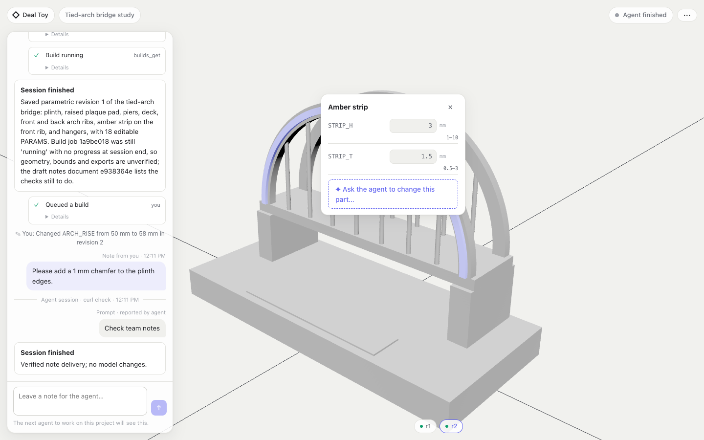

# Mantel

An AI-native CAD workspace, built for the United AI deal-toy service project (this repository is still named `deal-toy`). Organize design projects, let external AI agents create versioned build123d models through MCP, inspect 3D results, and collect the manufacturing details that belong to each revision.

## Status

Alpha at [Mantel](https://unitedai-deal-toy.ivan27chen.workers.dev). Anyone can create an account with Google; new accounts get the read-only demo, and the owner decides what else each person may do through editable access levels. People connect MCP clients by signing in from the client and selecting Allow. The implemented slice includes project and model creation, immutable Python revisions, queued native OCCT builds, STEP/STL/GLB exports, draft manufacturing documents, versioned skills and registered tool controls. Agent sessions are shown live: the agent's prompt, its progress updates and every tool call stream into a chat-style panel beside the 3D model. Clicking a part shows its declared dimensions; changing one saves and rebuilds a new revision. Models can be written as a list of named modeling steps (body, plane, extrude, hole, fillet, chamfer, text, combine, move and custom); every action describes itself to the agent, each build reports every step's health, and a timeline under the model shows it and lets the owner turn steps off and on or view the model as of any step (see [examples/deal_toy_steps.py](examples/deal_toy_steps.py)). Custom Python steps can be saved as versioned, self-describing actions once a check build proves their example, and any action's common inputs can be saved as presets. Every build also records exact measurements from OCCT: click a face to read its type, area, normal, diameter or thickness, shift-click a second face or part to measure between them, and cut a section along X, Y or Z with each part's cut filled in its own shade. The record reports deal-toy facts (how far the model can tip, how close an embedded object comes to the outside, declared dimensions against their parameters), agents read it with `inspect_get`, and they point at faces for the team with `view_highlight`. Each model also has a saved list of checks that people and agents edit together (stability, embed wall, declared dimension, clearance, no overlap, envelope, hole and draft). Every build shows each check as pass, fail or unknown, with the reason when it is unknown and what changed since the previous revision, and failures are coloured on the model. Presets add the usual deal-toy checks with limits left for the maker to confirm, and a passing list is never shown as manufacturing approval. Gaps the record cannot answer, such as between two curved faces, are measured exactly by a measure job on the build's STEP. A declared dimension can be changed by typing a new value or dragging its face, which saves one parameter edit as a new revision. Scripts can declare how parts attach with build123d joints (rigid, sliding or hinged). The record lists each joint, an explode slider pulls the parts apart along their joints and back together, and on desktop **Move parts** drags a part along its joint. When a placement parameter drives the joint, releasing saves it as a new revision; otherwise the move is for viewing only, with a Reset (see [examples/display_box_fit.py](examples/display_box_fit.py)). People use the same actions as the agent: "+ Add step" lists the catalog and saved actions. Each opens a form generated from the action's described inputs. Clicking the model fills a face field with a stable reference, a dashed preview shows the result before it is added, and presets fill or save inputs. The timeline edits, renames, removes and reorders steps, and the agent's model summary says what the person has selected. Team members can leave notes that agents receive on their next tool call. Agents now work inside an enforced structure: before any geometry they record a design sheet (what they asked the person about each section, with guesses marked as assumed, and the framework of layers the model is built from), and every later change starts with a change plan that declares the layers it adds, edits, removes or renames. Mantel refuses agent saves outside the sheet and the open plan, and every revision records the change that made it; people's own edits are never blocked. The catalog adds `revolve`, `loft`, `sweep`, `shell` and part-level `appearance` for round, blended and coloured parts (see [the tea cup reference](examples/tea_cup_steps.py) and [its design sheet](examples/tea_cup_design.json)), and the workspace menu shows a model's design sheet. The live selector on the model while an agent works, the layers panel and the change timeline are the next increments. The interface has light and dark themes. It is not a complete manufacturing automation service. See [validation](docs/validation.md) for tested paths and deployment status, and [roadmap](docs/roadmap.md) for remaining capabilities.



[Dark theme](docs/images/workspace-dark.png) · [Phone](docs/images/workspace-mobile.png) · [Sign in](docs/images/signin-light.png) · [Access levels](docs/images/settings-levels.png) · [Demo, view only](docs/images/demo-viewer.png)

## Architecture

- **Cloudflare Worker:** web application, Google sign-in, authenticated HTTP API and stateless MCP endpoint.
- **D1:** members, access levels, hashed sessions, project metadata, model source revisions, jobs and documents.
- **R2:** revision-linked binary exports with checksums.
- **Cloudflare Queue + Containers:** isolated Python/build123d/Open CASCADE jobs, with no internet access or credentials.
- **React + Three.js:** project library, model source editor and GLB viewer.

[Architecture and contracts](docs/architecture.md) · [Manufacturing handoff](docs/manufacturing.md) · [Deployment and rollback](docs/deployment.md)

## Prerequisites

Node.js 24.11 or later, npm, uv 0.11.26, Python 3.12 (uv can manage it), and a running Docker-compatible engine. Linux native CAD needs `libgl1 libglu1-mesa libxrender1 libxext6`. Production needs a Cloudflare account with Containers/Workers Paid, D1, R2 and Queues, plus GitHub Actions availability. Check account plans before activating deployment.

## Local quickstart

```sh
git clone https://github.com/UnitedAI-Projects/deal-toy.git
cd deal-toy
npm ci --ignore-scripts
uv sync --project engine --python 3.12 --frozen
npm run build
npm run db:local
mkdir -p work
node ci/member.mjs --local you@example.com owner work/owner-link.txt
npm run dev
```

Open the link in `work/owner-link.txt` (for example `http://localhost:8787/link#…`) on the same computer and select **Continue**. The link signs you in once, within 15 minutes, as the owner of your local database; run the command again for a new one. Google sign-in works locally too once you set `GOOGLE_CLIENT_ID` in `wrangler.jsonc` (or `.dev.vars`) and `GOOGLE_CLIENT_SECRET` in `.dev.vars`, with `http://localhost:8787/api/auth/google/callback` as an authorized redirect URI. When developing on a remote host, establish an SSH forward to the printed port before using localhost on your client computer.

Create a project, open its model workspace and select **Build model**. The editor starts with the synthetic bridge example. After the queued build succeeds, inspect the model and download its STEP, STL, GLB and geometry report. Source changes need a new saved revision and build. In **Manufacturing documents**, save a draft brief linked to the selected revision.

## Accounts and access

- **Sign in:** Continue with Google. The first sign-in creates an account at the default level (Demo). Email-and-password accounts are planned once Mantel has a domain for verification email.
- **Levels:** an owner edits named sets of permissions in **Settings → Access levels**: view the demo, create projects, edit models, run builds, download exports, leave notes, manage members, configure skills and tools. Each person has one level, plus optional per-person Allow and Revoke adjustments in **Settings → Members**. Revoke wins; owners have every permission.
- **Demo:** an owner marks one of their projects **Show as demo** from the workspace menu. People with "View the demo" can open it read-only; without "Download exports" they see the model and its activity but not its source or exports.
- **Recovery:** `node ci/member.mjs --remote email owner link.txt https://YOUR_APP` restores an owner and writes a one-time sign-in link, using your Wrangler D1 access.

## Connect an agent

In Claude Code:

```sh
claude mcp add --transport http mantel https://YOUR_APP/mcp
```

Sign in when Claude Code asks: it opens Mantel in your browser, you sign in with Google if needed and select **Allow**. In Claude's web or desktop app, add the same URL as a custom connector. Any MCP client that supports the MCP authorization standard (OAuth 2.1 with dynamic client registration) connects the same way.

The easiest way is **Settings → Connected apps → Set up your AI**: select **Copy instructions** and paste them into your AI app. They tell it how to add the server for its own app (Claude Code, Codex, Cursor, VS Code, or Claude's custom connector), walk you through sign-in, and have it confirm by listing your projects.

A connected app acts as you, with your current access level: a Demo member's app can read the demo but not edit or build. Its sign-in lasts a week and renews itself while you keep using it. See and disconnect your apps in **Settings → Connected apps**; disconnecting stops an app at once, as do suspension and access changes.

`/mcp` accepts only these sign-ins; there are no API keys. Retrieve `skills_list` and follow the `modeling` skill before modeling.

The agent must send its starting information before any geometry. Mantel enforces the order: a save that skips a step is refused with a message naming the tool to call.

```text
session_start({projectId, prompt})                       → sessionId; the prompt appears live
models_create({sessionId, projectId, name})
  … the agent questions the person about every section in its own client …
design_start({sessionId, modelId, request, sections, framework})
                                                         → the design sheet and the framework plan
models_save({sessionId, modelId, expectedRevision: 0, source})   (skeleton: PARAMS, base() → None)
change_progress({sessionId, planId, layer, phrases})     → before each framework layer
steps_add({sessionId, modelId, expectedRevision, action, name, inputs})
change_finish({sessionId, planId, summary})              → the framework is built

change_begin({sessionId, modelId, request, edit: ["Handle"], follow: [...]})   → each later request
change_progress(…), steps_edit(…), change_finish(…)
session_end({sessionId, summary})                        → also stops any plan left open
```

Every tool accepts an optional `sessionId`. The app records every agent tool call itself; the prompt and progress notes are reported by the agent and labelled that way. Notes left by the team are appended to the agent's next tool result as quoted data.

Python source defines `build()` returning build123d parts. Declare editable dimensions in a top-level `PARAMS` dictionary and return a `Compound` of labelled parts so each part is selectable. Use millimetres and Z up. See [the editable bridge example](examples/bridge.py).

## Extend

People with "Configure skills and tools" add and version Markdown workflows in **Skills and tools**. Built-in workflows live in `skills/`. Add executable actions through `src/server/tools.ts`, reuse the domain authorization functions, test denial paths, and submit a PR. UI and MCP share the same tool registry and enablement controls.

## Validate

```sh
bash ci/run.sh
docker build -f engine/Dockerfile -t deal-toy-cad:test .
bash ci/container-smoke.sh
```

The first command checks formatting, TypeScript, Worker behavior, browser build, dependency audit, Python lint/tests, and Worker packaging. The container smoke test runs actual CAD exports with networking disabled and a read-only filesystem. CI uses GitHub-hosted Linux workers; production deployment has separate credentials. No agent runner is included.

## Examples and artifacts

[Artifact index](examples/README.md) includes the editable source and actual STEP, STL, GLB and geometry report. Open STEP in a CAD application, STL in a mesh tool or slicer, and GLB in a glTF viewer. These are synthetic demonstrations, not production-approved designs.

## Contributing and licensing

Read [CONTRIBUTING.md](CONTRIBUTING.md) and [AGENTS.md](AGENTS.md). Report reproducible problems through repository issues using synthetic data; report credentials or private customer data privately to a maintainer. The repository is private and has no selected redistribution license. Dependency licenses remain applicable; see [third-party notices](THIRD_PARTY_NOTICES.md). Resolve project licensing before a public release.
