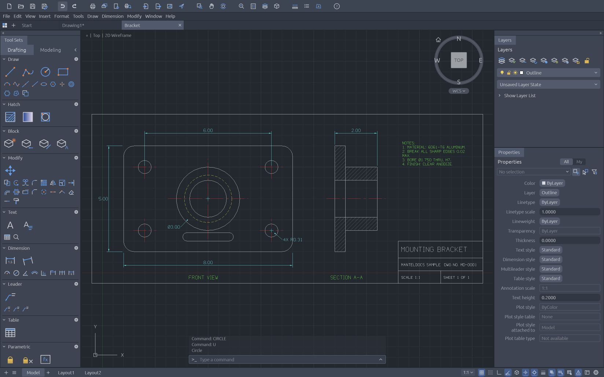

<p align="center"></p>

# MantelDocs

A CAD drafting workspace for desktop, browser, and command line. MantelDocs supports 2D drawing commands, object snaps, layers, dimensions, hatches, blocks, layouts, DXF exchange, and PDF/PNG/SVG exports.

**Status:** an independent, pre-alpha fork of [CADCraft](https://github.com/storytold/cadcraft), based on revision `2f8f1861886412f529900b37e3f80f8d1e2af119`. This release changes branding and product identity; it does not add CAD features. DWG exchange remains incomplete and may lose unsupported data. The 3D tools are early work. Use copies of important drawings.



## Quickstart

Install Rust 1.95 or newer with Cargo. Linux additionally needs the graphics development packages listed in [.github/workflows/checks.yml](.github/workflows/checks.yml). No account or service credentials are required to build.

```sh
git clone --branch feat/manteldocs-branding https://github.com/ichen27/manteldocs.git
cd manteldocs
cargo run --locked -p manteldocs -- --sample
```

The repository is currently private, so cloning requires access. The command selects the MantelDocs preview branch while [PR #1](https://github.com/ichen27/manteldocs/pull/1) is unmerged. For a smaller headless example:

```sh
cargo run --locked -p manteldocs-cli -- run --sample --export drawing.png
cargo run --locked -p manteldocs-cli -- info examples/apartment.dxf
cargo run --locked -p manteldocs-cli -- mcp
```

Type `LINE 0,0 10,10` in the app command line to draw a line. See [the control protocol](docs/control-protocol.md) for automation.

### Browser build

Install Trunk and the WebAssembly target:

```sh
rustup target add wasm32-unknown-unknown
cargo install trunk --locked
cd apps/manteldocs-web
trunk serve --open
```

The browser build serves at `http://127.0.0.1:8771`. When running remotely, forward that port to your client first. Run `trunk build --release` to produce a portable static site in `dist/web`.

### Validation

```sh
rustup target add wasm32-unknown-unknown
bash ci/run.sh
```

This runs formatting, Clippy, workspace tests, asset attribution, dependency layering and WebAssembly checks. Optional bundled fonts use `CRAFT_FONTS_DIR`; the app and tests work without that input.

## Product identity

The desktop binary is `manteldocs`, the command-line binary is `manteldocs-cli`, and app IDs use `com.manteldocs.app`. Settings and environment variables use MantelDocs names, keeping them separate from CADCraft. Windows installers have a distinct upgrade identity. Internal DXF extension identifiers remain compatible with existing CADCraft drawings. The Help menu opens this repository's releases; automatic upstream updates are disabled.

## Source and artifacts

- [Documentation index](docs/README.md): MantelDocs guides and directory naming.
- [Artifact index](docs/artifacts.md): editable artwork, samples, screenshots, and downloadable build status.
- [Architecture](docs/architecture.md): workspace crate boundaries.
- [Upstream limitations](docs/gaps.md): inherited feature gaps; historical estimates are not new MantelDocs measurements.
- [Contributing](CONTRIBUTING.md) and [security reporting](SECURITY.md).

## License and upstream credits

Code is available under [MIT](LICENSE-MIT) or [Apache-2.0](LICENSE-APACHE). Original copyright and third-party notices remain in [NOTICE](NOTICE) and [ATTRIBUTION.md](ATTRIBUTION.md). MantelDocs modifications are by ichen27. ArtCraft trademark artwork is excluded from this distribution. Pinned upstream libraries retain their original names and licenses.
