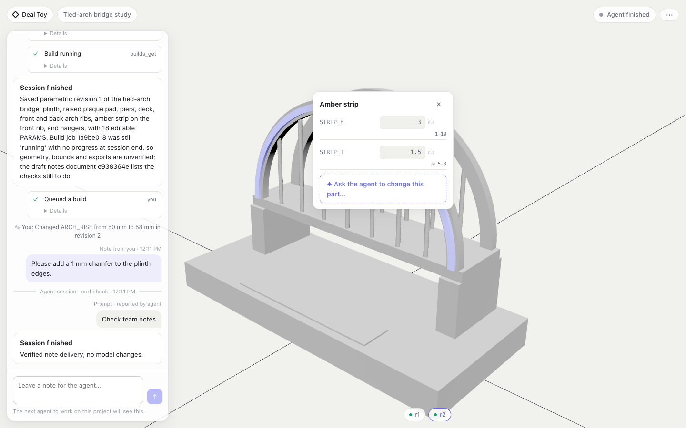

# Deal Toy Studio

An internal CAD workspace for the United AI deal-toy service project. Organize design projects, let external AI agents create versioned build123d models through MCP, inspect 3D results, and collect the manufacturing details that belong to each revision.

## Status

Internal alpha at [Deal Toy Studio](https://unitedai-deal-toy.ivan27chen.workers.dev), using Google sign-in through Cloudflare Access for the approved owner (`ivan27chen@gmail.com`). Browser users do not need to paste an app token; MCP clients still use administrator-issued personal tokens. The implemented slice includes project and model creation, immutable Python revisions, queued native OCCT builds, STEP/STL/GLB exports, draft manufacturing documents, versioned skills and registered tool controls. Agent sessions are shown live: the agent's prompt, its progress updates and every tool call stream into a chat-style panel beside the 3D model. Clicking a part shows its declared dimensions; changing one saves and rebuilds a new revision. Team members can leave notes that agents receive on their next tool call. The interface has light and dark themes. It is not a complete manufacturing automation service. See [validation](docs/validation.md) for tested paths and deployment status, and [roadmap](docs/roadmap.md) for remaining capabilities.



[Dark theme](docs/images/workspace-dark.png) · [Phone](docs/images/workspace-mobile.png)

## Architecture

- **Cloudflare Worker:** web application, authenticated HTTP API and stateless MCP endpoint.
- **D1:** membership, token hashes, project metadata, model source revisions, jobs and documents.
- **R2:** revision-linked binary exports with checksums.
- **Cloudflare Queue + Containers:** isolated Python/build123d/Open CASCADE jobs, with no internet access or credentials.
- **React + Three.js:** project library, model source editor and GLB viewer.

[Architecture and contracts](docs/architecture.md) · [Manufacturing handoff](docs/manufacturing.md) · [Deployment and rollback](docs/deployment.md)

## Prerequisites

Node.js 24.11 or later, npm, uv 0.11.26, Python 3.12 (uv can manage it), and a running Docker-compatible engine. Linux native CAD needs `libgl1 libglu1-mesa libxrender1 libxext6`. Production needs a Cloudflare account with Containers/Workers Paid, D1, R2 and Queues, plus GitHub Actions availability. Check account plans before activating deployment.

## Local quickstart

```sh
git clone https://github.com/UnitedAI-Projects/deal-toy.git
cd deal-toy
npm ci --ignore-scripts
uv sync --project engine --python 3.12 --frozen
npm run build
npm run db:local
mkdir -p work
node ci/member.mjs --local you@example.com admin work/local-token.txt
npm run dev
```

Open the URL printed by Wrangler on the same computer. Paste the token from `work/local-token.txt` into the sign-in form. It is a local-only token. When developing on a remote host, establish an SSH forward to the printed port before using localhost on your client computer.

Create a project, open its model workspace and select **Build model**. The editor starts with the synthetic bridge example. After the queued build succeeds, inspect the model and download its STEP, STL, GLB and geometry report. Source changes need a new saved revision and build. In **Manufacturing documents**, save a draft brief linked to the selected revision.

## Connect an agent

Use a Streamable HTTP MCP client with server URL `https://YOUR_APP/mcp` and an `Authorization: Bearer YOUR_PERSONAL_TOKEN` header. Store the token in the client's secret manager. Retrieve `skills_list` and follow the `modeling` skill before modeling.

Typical sequence:

```text
session_start({projectId, prompt})            → sessionId; the prompt appears live
session_update({sessionId, message})          → a short progress note
models_create({sessionId, projectId, name})
models_save({sessionId, modelId, expectedRevision: 0, source})
models_build({sessionId, revisionId})
builds_get({sessionId, jobId})
documents_add({sessionId, projectId, revisionId, kind: "manufacturing-brief", title, content})
session_end({sessionId, summary})
```

Every tool accepts an optional `sessionId`. The app records every agent tool call itself; the prompt and progress notes are reported by the agent and labelled that way. Notes left by the team are appended to the agent's next tool result as quoted data.

Python source defines `build()` returning build123d parts. Declare editable dimensions in a top-level `PARAMS` dictionary and return a `Compound` of labelled parts so each part is selectable. Use millimetres and Z up. See [the editable bridge example](examples/bridge.py). Clients requiring OAuth cannot yet connect through a browser consent flow; that adapter is planned.

## Extend

Administrators add and version Markdown workflows in **Skills & tools**. Built-in workflows live in `skills/`. Add executable actions through `src/server/tools.ts`, reuse the domain authorization functions, test denial paths, and submit a PR. UI and MCP share the same tool registry and enablement controls.

## Validate

```sh
bash ci/run.sh
docker build -f engine/Dockerfile -t deal-toy-cad:test .
bash ci/container-smoke.sh
```

The first command checks formatting, TypeScript, Worker behavior, browser build, dependency audit, Python lint/tests, and Worker packaging. The container smoke test runs actual CAD exports with networking disabled and a read-only filesystem. CI uses GitHub-hosted Linux workers; production deployment has separate credentials. No agent runner is included.

## Examples and artifacts

[Artifact index](examples/README.md) includes the editable source and actual STEP, STL, GLB and geometry report. Open STEP in a CAD application, STL in a mesh tool or slicer, and GLB in a glTF viewer. These are synthetic demonstrations, not production-approved designs.

## Contributing and licensing

Read [CONTRIBUTING.md](CONTRIBUTING.md) and [AGENTS.md](AGENTS.md). Report reproducible problems through repository issues using synthetic data; report credentials or private customer data privately to a maintainer. The repository is private and has no selected redistribution license. Dependency licenses remain applicable; see [third-party notices](THIRD_PARTY_NOTICES.md). Resolve project licensing before a public release.
