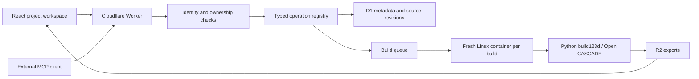

# Architecture

The first release is an authenticated internal workspace with project-owned models, immutable source revisions, queued native builds, downloadable exports, draft manufacturing documents and an extensible MCP tool catalog.

## Why these boundaries

Cloudflare Workers serve the application, authorization and remote MCP. Native OCCT libraries run in a Linux container. The build123d Python interface is the modeling language; OCCT is its geometric kernel, not a separately reimplemented engine. External agents write and revise Python through MCP; the application does not run an LLM or consume a provider API key.

D1 stores projects, models, immutable source revisions, build status, artifact metadata, document history, skill history and hashed personal tokens. R2 stores binary exports. The application persists completed exports before destroying the container, because container disk is ephemeral. Queue redelivery does not implicitly reexecute a running job; stale claims fail after fifteen minutes and the caller can submit a new build.

Each project currently has one owner. Team membership allows application access, but does not expose another member's projects. Shared project ACLs are a planned additive capability.

## Agent contracts

A tool is a typed schema, description, read-only annotation and handler. Both HTTP and MCP call `execute`, including current tool settings and authorization. Add operations to the registry and test their authorization/failure paths. The interface lists registered tools and allows administrators to disable them; adding server executable code requires a reviewed deployment.

A skill is versioned Markdown workflow guidance. Two built-in skills ship with the app. Administrators can publish replacements or new skills in the interface. Read the latest catalog through `skills_list` or `deal-toy://skills`. This does not automatically install skills in a client's local skill directory, nor does it grant tools permissions. Clients must explicitly retrieve and follow the workflows.

`models_save` accepts an expected revision and uses a transactional conditional write. Source conflicts never silently overwrite newer work. Builds reference immutable revision IDs; documents reference that same revision. A source edit does not update old exports or old documentation.

## Identity and isolation

Cloudflare Access browser identities are verified using signature, issuer and audience, then checked against active membership. Personal bearer tokens are stored only as SHA-256 hashes and checked for expiration and active membership on every request. The initial token UI stores its token only in the browser session. OAuth consent/token issuance for chat clients is not implemented; use a client that supports bearer headers until that adapter exists.

Generated Python is arbitrary code. No AST filter is described as a sandbox. Its real boundary is a fresh container with public egress disabled and no credentials, no other projects, and no persistent mounts. A subprocess adds CPU, wall-time, file-size and process bounds. OCCT uses a single native thread to avoid exporter stalls when Linux counts other same-user tasks against the process limit. The container is destroyed after each job. Only four allowlisted artifacts are persisted, with size limits and checksums. Geometry facts describe the submitted build, not an independent manufacturing certification.

A small global queue admission bound and two concurrent queue consumers limit initial load. Each consumer starts one job-specific container using the `durable_object` scheduling policy and the Worker version's named image. There is no platform application-level instance cap under this policy; failed cleanup is bounded by a persistent three-minute destruction alarm. This is an internal alpha; adversarial multi-tenant deployment additionally needs per-member rate limits, usage budgets and independent post-execution artifact verification.

## References inspected on 2026-10-27

- [build123d](https://github.com/gumyr/build123d): Python parametric CAD and STEP/STL/GLB exports. Pinned package and transitive dependencies are in `engine/uv.lock`.
- [text-to-cad](https://github.com/earthtojake/text-to-cad): reference for source-first modeling, geometry inspection, visual checks, derived drawings and manufacturing-specific workflows. Its local warm engine and host plugin UI are not a hosted multi-user application or a security boundary. We do not vendor its runtime.
- [Cloudflare Containers](https://developers.cloudflare.com/containers/get-started/): native Linux execution behind a Worker.
- [MCP TypeScript SDK](https://github.com/modelcontextprotocol/typescript-sdk): stateless Streamable HTTP server.
- [Slice launcher deployment](https://github.com/sliceconsultingsu/slice-launcher/blob/main/.github/workflows/deploy-launcher.yml): separate validation/release jobs, production credentials, current-source verification and live release checks. This project deliberately excludes Slice's agent review pipeline.
