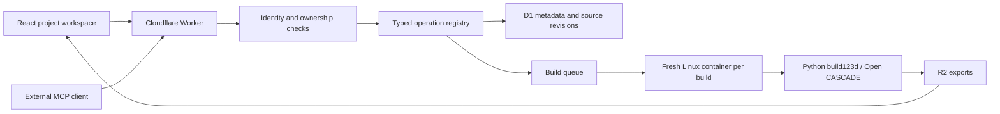

# Architecture

The first release is an authenticated internal workspace with project-owned models, immutable source revisions, queued native builds, downloadable exports, draft manufacturing documents and an extensible MCP tool catalog.

## Why these boundaries

Cloudflare Workers serve the application, authorization and remote MCP. Native OCCT libraries run in a Linux container. The build123d Python interface is the modeling language; OCCT is its geometric kernel, not a separately reimplemented engine. External agents write and revise Python through MCP; the application does not run an LLM or consume a provider API key.

D1 stores projects, models, immutable source revisions, build status, artifact metadata, document history, skill history, members, access levels, and hashed browser sessions, sign-in links and API keys. R2 stores binary exports. The application persists completed exports before destroying the container, because container disk is ephemeral. Queue redelivery does not implicitly reexecute a running job; stale claims fail after fifteen minutes and the caller can submit a new build.

Each project has one owner, who alone writes to it. Projects flagged as demos are readable by members with "View the demo". Shared project ACLs are a planned additive capability.

## Agent contracts

A tool is a typed schema, description, read-only annotation and handler. Both HTTP and MCP call the shared dispatcher, including current tool settings and authorization. Add operations to the registry and test their authorization/failure paths. Each tool declares the permissions it needs, which the dispatcher checks before it runs. The interface lists registered tools and allows members with "Configure skills and tools" to disable them; adding server executable code requires a reviewed deployment.

A skill is versioned Markdown workflow guidance. Two built-in skills ship with the app. Members with "Configure skills and tools" can publish replacements or new skills in the interface. Read the latest catalog through `skills_list` or `mantel://skills`. This does not automatically install skills in a client's local skill directory, nor does it grant tools permissions. Clients must explicitly retrieve and follow the workflows.

`models_save` accepts an expected revision and uses a transactional conditional write. Source conflicts never silently overwrite newer work. Builds reference immutable revision IDs; documents reference that same revision. A source edit does not update old exports or old documentation.

## Agent sessions and live activity

See [the design](superpowers/specs/2026-10-28-agent-live-workspace-design.md) for intent and decisions.

- **Sessions** are declared by agents with `session_start` (verbatim prompt), `session_update` and `session_end`. Every tool accepts an optional `sessionId`. The MCP transport stays stateless.
- **Recording.** The dispatcher appends one `project_events` row per agent (MCP) tool call, and per mutating call from the interface: tool, success, duration, a short summary and clipped arguments. Source code is never stored in events: the revision holds it. Agent-reported content (prompt, updates, summary) is labelled as reported in the interface. Per-event and per-session size caps apply.
- **Team notes** (`notes_add`) and parameter edits are project events. Each is delivered once to every session that was running when it was written, appended to that session's next MCP tool result as quoted data. A note written while no session runs waits for the next `session_start` (or a session-less `projects_get`). Deliveries are recorded in `note_deliveries`.
- **Live delivery.** One `ProjectLive` Durable Object per project relays new events and "workspace changed" signals to browsers over hibernating WebSockets. It stores no project data; D1 is the record, and browsers load history with `projects_activity` before following the stream. Browsers cannot send bearer headers on a socket, so the authenticated API issues a single-use, 60-second ticket bound to that project's relay. Socket upgrades pass the same same-origin check as other API requests.
- **Parameters.** Model scripts declare editable dimensions in `PARAMS` with a part label, unit and optional range. The runner reads them inside the sandbox after `build()` and adds them, with the labelled parts and their volumes, to the geometry facts. `models_set_parameter` replaces exactly one numeric `value` literal in the latest revision's source, refusing ambiguous, computed or out-of-range edits, then saves a new revision through the normal conflict check and queues its build. `volume_mm3` sums part volumes, so overlapping parts count twice.
- **Viewers.** Only the owner's own calls are recorded and only the owner's sessions receive notes. Someone reading a demo sees "team" in place of member emails, in reads and in the copy of each live event sent to viewer sockets (tickets record whether the socket belongs to the owner).

## Identity and isolation

See [the accounts design](superpowers/specs/2026-10-28-accounts-and-access-design.md).

- **Sign-in.** Google OAuth 2.0 with PKCE, `state` and `nonce`. The callback verifies the ID token's signature against Google's keys, its issuer, audience, expiry and nonce, and requires a verified email. A verified email links to an existing member only while that member has no Google subject; afterwards the member is found by subject, so a different Google account cannot take it over. New members get the default level.
- **Sessions.** A random 32-byte token in a `__Host-mantel_session` cookie (`HttpOnly; Secure; SameSite=Lax`), stored only as a SHA-256 hash, valid 30 days and sliding. Cookie-authenticated writes must carry a same-origin `Origin` header. Operator sign-in links (`ci/member.mjs`) are single use, expire after 15 minutes, live in the URL fragment and are redeemed by a same-origin POST.
- **API keys.** `mtl_` plus 32 random bytes, shown once, stored as a SHA-256 hash with an 8-character prefix. Accepted only by `/mcp`; the browser API accepts only sessions. Each request checks expiry, revocation, the member's status and the "API keys and MCP" permission.
- **Permissions.** Every request reloads the member's level, allows and revokes from D1, so suspension and permission changes apply on the next request. Delegated administrators (not owners) are judged on the access a change would leave the person with, may only edit levels whose members they could edit directly, and cannot change owners or themselves. At least one active owner always remains. Changes are written to `audit_events`.
- **Abuse limits.** New accounts can only view the demo, so signup alone costs no compute. Google sign-in is rate-limited per IP, and builds are capped per member per day (`DAILY_BUILD_LIMIT`). OAuth for MCP clients is not implemented; use a client that supports bearer headers.

Generated Python is arbitrary code. No AST filter is described as a sandbox. Its real boundary is a fresh container with public egress disabled and no credentials, no other projects, and no persistent mounts. A subprocess adds CPU, wall-time, file-size and process bounds. OCCT uses a single native thread to avoid exporter stalls when Linux counts other same-user tasks against the process limit. The container is destroyed after each job. Only four allowlisted artifacts are persisted, with size limits and checksums. Geometry facts describe the submitted build, not an independent manufacturing certification.

A small global queue admission bound and two concurrent queue consumers limit initial load. Each consumer starts one job-specific container using the `durable_object` scheduling policy and the Worker version's named image. There is no platform application-level instance cap under this policy; failed cleanup is bounded by a persistent three-minute destruction alarm. This is an alpha; an adversarial multi-tenant deployment additionally needs usage budgets beyond the daily build cap and independent post-execution artifact verification.

## References inspected on 2026-10-27

- [build123d](https://github.com/gumyr/build123d): Python parametric CAD and STEP/STL/GLB exports. Pinned package and transitive dependencies are in `engine/uv.lock`.
- [text-to-cad](https://github.com/earthtojake/text-to-cad): reference for source-first modeling, geometry inspection, visual checks, derived drawings and manufacturing-specific workflows. Its local warm engine and host plugin UI are not a hosted multi-user application or a security boundary. We do not vendor its runtime.
- [Cloudflare Containers](https://developers.cloudflare.com/containers/get-started/): native Linux execution behind a Worker.
- [MCP TypeScript SDK](https://github.com/modelcontextprotocol/typescript-sdk): stateless Streamable HTTP server.
- [Slice launcher deployment](https://github.com/sliceconsultingsu/slice-launcher/blob/main/.github/workflows/deploy-launcher.yml): separate validation/release jobs, production credentials, current-source verification and live release checks. This project deliberately excludes Slice's agent review pipeline.
