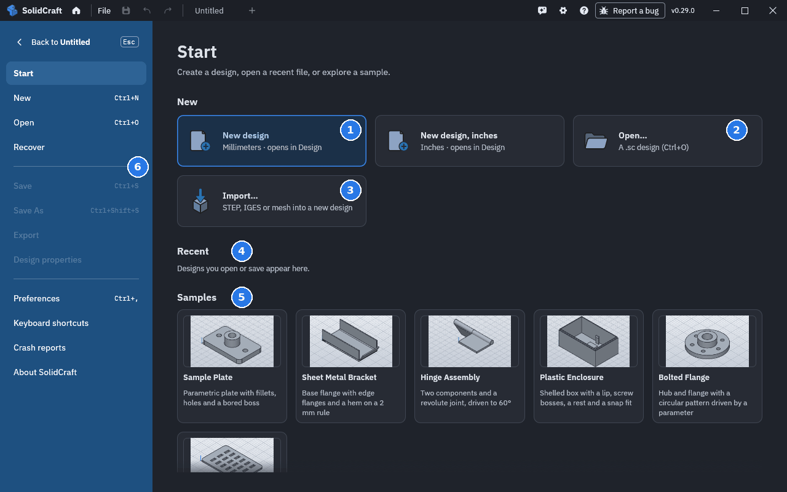
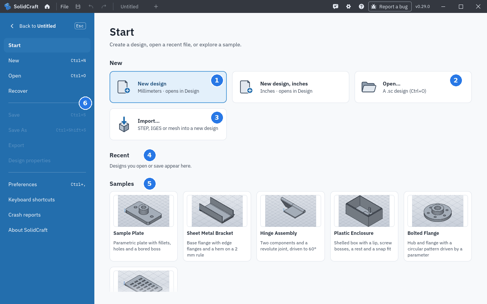

# Getting started

MantelCAD currently ships as source. There is no published MantelCAD installer, Snap/Flatpak feed, container-registry image or hosted web application. See the [README quickstart](https://github.com/ichen27/mantelcad#quickstart) for prerequisites and the [download status](https://github.com/ichen27/mantelcad/blob/main/docs/downloads.md) for availability. Screenshots and recordings retained in this manual may show the upstream interface.

The desktop executable is `mantelcad`, the CLI is `mantelcad-cli`, and new designs use `.sc`. Legacy `.solidcraft` and `.solvecraft` designs remain recognized. The [fork notes](https://github.com/ichen27/mantelcad/blob/main/docs/mantelcad-fork.md) explain identity, licensing and file compatibility.

## Desktop

With the README prerequisites installed, build and open the sample part:

```sh
git clone https://github.com/ichen27/mantelcad.git
cd mantelcad
cargo run --release --locked -p mantelcad -- --sample
```

To open a saved design or import a STEP file, replace `--sample` with its path. The compiled executable is in `target/release/`. Access to the repository is required while it is private.

### The start page

MantelCAD opens on the start page; the house at the top left brings it back.




**1** A new design in millimetres (or inches, beside it) · **2** Open a saved design ·
**3** Import a STEP, IGES or mesh file as a new design · **4** Designs you opened recently ·
**5** Samples to explore · **6** The File menu: save, export, preferences, shortcuts

A sample opens as an ordinary design you can change; a click on its tile is enough.

<video src="../media/getting-started/sample.mp4" autoplay loop muted playsinline controls width="100%" aria-label="Clicking the Sample Plate tile on the start page: the sample opens, and the view turns to look round it"></video>

From there, [A tour of the window](ui-tour.md) shows what's where, and
[Sketching step by step](sketching.md#step-by-step) starts a part of your own.

### Platform packages

The repository contains macOS, Windows and Linux package scripts for future release preparation. They are not published installers. Read the relevant script and the [build guide](https://github.com/ichen27/mantelcad/blob/main/docs/building.md) before packaging. Signing and notarization require separately configured credentials and verification; no MantelCAD signing status is claimed by the source build.

## Web

The browser application can be built and served from this checkout. Install Trunk, add the WebAssembly target, then run:

```sh
rustup target add wasm32-unknown-unknown
cd apps/mantelcad-web
trunk serve --release --no-autoreload
```

Use the address printed by Trunk on the machine running it. For a remote development machine, forward its port or serve it through an HTTPS route accessible to your browser. Browser design storage requires HTTPS or localhost.

`?sample` opens the sample part, and `?webgl` requests WebGL2. Offline support needs a release build without Trunk's automatic reload (`--no-autoreload`); debug builds do not keep an offline copy. There are no published MantelCAD release-candidate or edge web channels.

### Design links and embeds

The URLs below assume your own deployment; `cad.example` is a placeholder, not a MantelCAD service.

Use `?open=<encoded HTTPS URL>` to open a hosted `.sc` design as an unsaved
copy, including its history, constraints, and joints. Encode the URL with
`encodeURIComponent` when it contains query parameters. The host must allow CORS
requests from the app's origin. Downloads, including redirected URLs, must use HTTPS
or stay on the app's own origin, and fit within the File > Open design size limit.
Failed downloads and invalid designs show an error and leave the empty design.

For self-hosting, `?open=/dutchman/jobs/abc/part.sc` resolves against the
page's origin, using its scheme and port, including plain HTTP on a LAN. A full URL
on that same origin is also accepted; other absolute URLs still require HTTPS.
For example, expose a reverse-proxy service in Compose, routing `/` to
`mantelcad:8080` and `/dutchman/` to a converter service. The converter can link to
`/?open=/dutchman/jobs/abc/part.sc` without a separate origin or CORS setup.
Paths must start with one `/`; protocol-relative paths (`//`), backslashes, control
characters, and decoded `..` segments are refused. Redirects must end at HTTPS or
the page's own origin. Embed mode and **Open in MantelCAD** preserve the path.

Add `embed` to show the viewport, timeline, browser tree, and joint controls without
the ribbon, file menus, or start page:

```html
<iframe src="https://cad.example/app/?embed&open=https://example.org/arm.sc"
        width="960" height="540" title="Arm design"></iframe>
```

Embedded designs do not save designs, preferences, or recovery copies to browser
storage and do not ask before unloading. **Open in MantelCAD** opens the same link
in the full app in a new tab. `?embed` without `open` keeps the normal app layout.

Use `embed=editor` instead for a page that keeps the designs itself and has people model in
the frame. It needs no `open`:

```html
<iframe src="https://cad.example/app/?embed=editor"
        width="1280" height="800" title="Modelling"></iframe>
```

The ribbon, browser tree, timeline and properties stay; the application bar and start page
do not. Ctrl+N, Ctrl+O, Ctrl+S, Ctrl+W and Ctrl+, do nothing there, because those belong to
the page; Ctrl+Z and Ctrl+Y still undo and redo. As with `embed`, nothing is kept in browser
storage: the page moves the design in and out with the `document.export` and
`document.import` control methods.

### Self-hosting with Docker

The included Compose file builds the web application from this checkout as `mantelcad-web:local`. It serves static files with nginx on port 8080; designs stay in the browser. From the repository root, run:

```sh
docker compose -f packaging/docker/compose.yaml up -d --build
```

Rebuild with the same command after updating the source. `MANTELCAD_PORT` selects another host port. On the Docker host, open `http://localhost:8080/`; for access from another computer, use a forwarded local port or an HTTPS reverse proxy. Plain remote HTTP does not provide the secure browser storage context.

To build without Compose:

```sh
docker build -f packaging/docker/Dockerfile -t mantelcad-web:local .
docker run --rm -p 8080:8080 mantelcad-web:local
```

There is no published MantelCAD container-registry image to pull. These commands build your local source, including its documented license notices.

### 3D mouse in the browser

The web app reads a 3Dconnexion SpaceMouse or SpaceNavigator through the browser's Gamepad API,
with the same switch and speed in Preferences › Navigation as the desktop app. Edge and Chrome
read the device as it is. A browser shows a gamepad to a page only once it has been moved there,
so if nothing happens at first, push the cap firmly once. 3DxWare also turns the cap into
mouse-wheel zoom in browsers; while the cap moves, the web app ignores the wheel and reads the
cap itself. Before the browser shows the cap to the page, that zoom still gets through, so the
first push after opening the page may zoom a little.

Firefox doesn't list 3D mice ([Mozilla bug 1226575](https://bugzilla.mozilla.org/show_bug.cgi?id=1226575)).
On Windows it does list 3DxWare's virtual joystick, which can carry the cap instead. Save this
as `%APPDATA%\3Dconnexion\3DxWare\Cfg\Firefox.xml`, then restart Firefox (and 3DxWare, if the cap
still only zooms). It changes Firefox only: there 3DxWare sends the cap's six axes to the
joystick instead of the mouse wheel. Delete the file to undo it.

```xml
<?xml version="1.0" encoding="UTF-8"?>
<AppCfg Default="false" xmlns="" CfgFormatVersion="1.3" ThisFileVersion="1.1">
  <AppInfo>
    <Signature>
      <Name>STR_FIREFOX</Name>
      <ExecutableName>FIREFOX.EXE</ExecutableName>
      <Transport>KMJ</Transport>
    </Signature>
    <Options/>
  </AppInfo>
  <CfgProperties>
    <ID>ID_STR_FIREFOX</ID>
    <Name>STR_FIREFOX</Name>
    <InheritsFromID>ID_STR_FIREFOX</InheritsFromID>
  </CfgProperties>
  <Devices>
    <Device>
      <ID>ID_Standard_3D_Mouse</ID>
      <AxisBank>
        <Name>STR_DEFAULT_BANK</Name>
        <ID>Default</ID>
        <Axis><Enabled>true</Enabled><Input><ActionID>HIDMultiAxis_X</ActionID><Min>-512</Min><Max>511</Max><Deadband>0</Deadband></Input><Output><ActionID>HIDJoystick_X</ActionID></Output></Axis>
        <Axis><Enabled>true</Enabled><Input><ActionID>HIDMultiAxis_Y</ActionID><Min>-512</Min><Max>511</Max><Deadband>0</Deadband></Input><Output><ActionID>HIDJoystick_Y</ActionID></Output></Axis>
        <Axis><Enabled>true</Enabled><Input><ActionID>HIDMultiAxis_Z</ActionID><Min>-512</Min><Max>511</Max><Deadband>0</Deadband></Input><Output><ActionID>HIDJoystick_Z</ActionID></Output></Axis>
        <Axis><Enabled>true</Enabled><Input><ActionID>HIDMultiAxis_Rx</ActionID><Min>-512</Min><Max>511</Max><Deadband>0</Deadband></Input><Output><ActionID>HIDJoystick_Rx</ActionID></Output></Axis>
        <Axis><Enabled>true</Enabled><Input><ActionID>HIDMultiAxis_Ry</ActionID><Min>-512</Min><Max>511</Max><Deadband>0</Deadband></Input><Output><ActionID>HIDJoystick_Ry</ActionID></Output></Axis>
        <Axis><Enabled>true</Enabled><Input><ActionID>HIDMultiAxis_Rz</ActionID><Min>-512</Min><Max>511</Max><Deadband>0</Deadband></Input><Output><ActionID>HIDJoystick_Rz</ActionID></Output></Axis>
      </AxisBank>
    </Device>
  </Devices>
</AppCfg>
```

## CLI

`mantelcad-cli` runs the same commands without a window:

```sh
cargo run --release -p mantelcad-cli -- commands                       # every command, as JSON
cargo run --release -p mantelcad-cli -- run examples/bracket.json --out bracket.step
cargo run --release -p mantelcad-cli -- eval examples/bracket.json     # volume, area, faces…
cargo run --release -p mantelcad-cli -- snapshot examples/bracket.json --out bracket.png
cargo run --release -p mantelcad-cli -- exec solid.box '{"length": 20, "width": 10, "height": 5}'
cargo run --release -p mantelcad-cli -- run mechanism.json --in arm.sc  # with a motion.export_animation step: a GIF
```

A script is a list of commands:

```json
{"commands": [
  {"command": "sketch.create", "params": {"plane": "XY"}},
  {"command": "sketch.rectangle.two_point", "params": {"p0": [0, 0], "p1": [40, 30]}},
  {"command": "sketch.finish", "params": {}},
  {"command": "solid.extrude", "params": {"distance": 20}},
  {"command": "solid.fillet", "params": {"edges": [[0, 0, 10]], "radius": 3}}
]}
```


`snapshot` looks at the model from the iso view. `--view NAME` takes another standard view (`front`, `back`, `top`, `bottom`, `left`, `right`) or the name of a view saved in the design with `view.save`. `--camera JSON` takes any camera, as the MCP `screenshot` tool does (its conventions are in [the MCP page](mcp.md#camera-and-close-up-recipe)). A script that applies a view itself with `view.apply` sets the camera too. The ground grid lies on Z 0, so it cuts through a part that straddles it: `--no-grid` leaves it out of the picture, and `--no-axes` the origin's axes. The picture is drawn on the GPU with the viewport's own pipelines, so it shows what the window would (a surface analysis such as `inspect.zebra` included); a machine without a GPU uses a software one (Mesa's lavapipe on Linux, WARP on Windows), and with neither (a Mac without usable Metal, a Linux box without Mesa's Vulkan) the CPU rasterizer draws it, without surface analysis colours, and the reply's `renderer` says `cpu` with a warning. `MANTELCAD_GPU=auto|hardware|software|cpu` chooses (`hardware` and `software` fail rather than fall to the CPU), and `mantelcad-cli gpu` lists the adapters and the tier a snapshot would use.

```sh
mantelcad-cli snapshot part.sc --out photo.png --view Photo
mantelcad-cli snapshot part.sc --out close-up.png --no-grid --no-axes --camera '{"target": [30, -20, 0], "yaw": 0.6, "pitch": 0.25, "distance": 60}'
```

### Seeing what a cut or a join is about to do

A picture answers in a glance what a volume cannot: does the tool body reach through the
material, and is it where you meant it to be? `--body NAME:opacity=0.3` draws that body
see-through, so whatever is inside it shows; `--body NAME:color=#cc3333` gives it a colour.
Either key on its own keeps what the design says about the other, and the option is a shortcut
for `appearance.assign`, the command the Appearance dialog runs — the picture is the one the
window would show with the same appearance assigned.

`--tool NAME` is the common case in one option: that body solid in the tool colour, every
other body see-through around it. `--section z=27` cuts the model at a plane so the inside
shows, as `inspect.section` does: an axis and the world coordinate to cut at, `,flip` to keep
the other side, `XY`, `XZ` or `YZ` for a plane through the origin, or the command's own JSON.


```sh
# The pin the cut would remove, inside the plate it stops 6 mm short of.
mantelcad-cli snapshot plate.sc --out preview.png --tool Pin
mantelcad-cli snapshot plate.sc --out cut.png --tool Pin --section z=12
mantelcad-cli snapshot plate.sc --out glass.png --body "Plate:opacity=0.25" --body "Pin:color=#1a7f4b"
```

A body drawn see-through is drawn see-through everywhere a picture is drawn, not only here:
an appearance with an opacity below 1 (`Glass - Clear` in the library, or any `opacity` you
assign) now reads as glass in `snapshot`, in MCP screenshots and in a design's thumbnail, as it
always has in the window. A face painted with a see-through look of its own still draws at its
body's opacity.

Windows PowerShell 5.1 drops the double quotes inside an argument it passes to a program: write them as `\"` there.

A command that fails stops the script. A feature can also fail later, when a parameter change
rebuilds it; `run` then exits with status 1, lists the failing features and writes none of
its `--out` and `--save` files, because the bodies lack what those features should have made.
`--allow-errors` writes them anyway.

`--quality standard|fine|finest` sets how closely an STL, OBJ or 3MF written by `--out`
follows curved faces, as `file.export`'s `quality` does: a chord tolerance of 2e-4, 5e-5 or
1e-5 of each body's size, though never under 1 µm, so on a small body `fine` and `finest`
can come out the same. The default is `standard`.

```sh
mantelcad-cli run --in part.sc --out part.stl --quality fine
```

`--param-check warn|strict` checks each step against its command's parameter contract, for the
commands that have one (`describe_command` in the MCP server shows them); the default, `off`,
checks nothing. A misspelt optional key, such as `operaton` for `solid.box`'s `operation`, is
otherwise ignored, and the step builds without it. `warn` runs the step and prints
``script.json: step 1: unknown key `operaton`; did you mean `operation`?`` on stderr; `strict`
stops the run at that step, and nothing is written.

`run` prints each command's result with `--results` (otherwise the measurement), and `eval`
prints the measurement, as JSON on stdout. `--json-out FILE` writes that JSON to a file
instead. The file is plain UTF-8, which is not what a redirect gives you everywhere: Windows
PowerShell's `>` re-encodes a program's output, as UTF-16 or as UTF-8 with a byte-order mark
depending on its settings, and strict JSON readers such as Python's `json.load` then refuse it.

```sh
cargo run --release -p mantelcad-cli -- run examples/bracket.json --results --json-out results.json
cargo run --release -p mantelcad-cli -- eval examples/bracket.json --json-out measures.json
```

To find the slow steps of a script, `--timings` prints how long each command took instead of
the measurement: `{"timings": [{"index", "command", "ms"}], "total_ms"}`, with `index` counted
from 0. `--profile` adds each command's `profile: {"boolean_ms", "tessellate_ms", "other_ms"}`,
its wall time in the kernel's booleans, in tessellation and in everything else, and prints the
profiler's table on stderr: where the time went, the kernel's calls to the commands
(`docs/perf.md`, "Where the time goes"); `--profile-out trace.json` also writes the spans as a
Chrome trace. `--profile` works on a design or STEP file too. With
`--results` as well, the results go in the same object as `results`; `--results` alone still
prints a plain array.

```sh
cargo run --release -p mantelcad-cli -- run examples/bracket.json --profile
```

A design's history turns into a script that rebuilds it, which makes a bug that only shows
on one design a one-file reproduction:

```sh
cargo run --release -p mantelcad-cli -- script part.sc --out repro.json
cargo run --release -p mantelcad-cli -- eval repro.json               # the same part
```

The script starts with the user parameters (`parameters.add`) and the design's units, sheet
metal and plastic rules and materials, then adds each timeline feature with `timeline.add`,
exactly as the design file holds it: same ids, names and parameter names, so later steps
still find the sketches and bodies they use, and a feature that failed in the design fails
the same way. Edit a step's values to try a change, or delete the steps after a feature to
see the design as it was there. Appearances, folders, named views and configurations are
left out (the CLI notes which), and designs with components or joints are not supported
yet. In the app and over MCP the same script comes from `timeline.export_script`.

Units are millimetres and degrees unless an expression says otherwise (`"1 in"`, `"30 deg"`),
and Z is up.

## Name and compatibility

MantelCAD uses its own application name, package names, settings identity, `MANTELCAD_*` environment variables and repository links. It retains upstream serialized file-format identifiers and legacy design extensions so the rename does not require a format migration. See [fork compatibility](https://github.com/ichen27/mantelcad/blob/main/docs/mantelcad-fork.md) for the supported boundary. Inherited historical upgrade notes are not a claim that MantelCAD has published older releases or automatically transfers every setting from another application.
