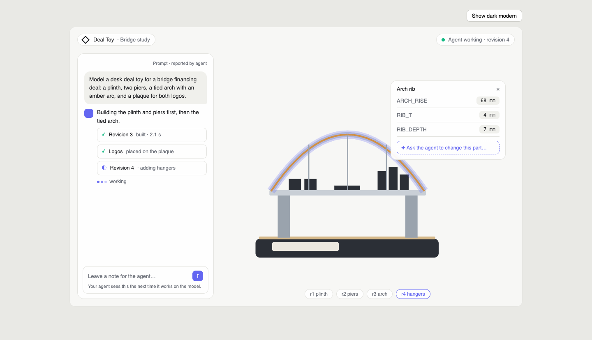

# Live agent workspace and interface redesign

Status: proposed design, 2026-10-28. Builds on the current foundation (`docs/architecture.md`).

## Intent

Deal Toy Studio is an AI-native CAD modeller. Most modelling happens through MCP: a team member prompts their own agent (Claude Code, Claude Desktop or another MCP client), and the agent writes build123d Python through the existing tools. Today the app shows none of that conversation. The prompt never reaches the server, there is no record of what the agent did, and the screen only refreshes while a build runs.

This change makes the agent's work the centre of the product. The prompt, the agent's progress updates and every revision appear live next to the model. Team members can click a part of the model to see and change its dimensions without opening code. The interface is redesigned to look modern and professional, in light and dark themes.

## Decisions already made

These were decided by the product owner and are not open:

- **Stack stays as is:** TypeScript on Cloudflare Workers, React with Three.js in the browser, Python build123d/OCCT in sandboxed containers. No Rust rewrite.
- **The modelling interface stays build123d code.** An agent writes a whole `build()` script per revision. A side-by-side trial against command-driven CAD (SolidCraft) on a hard past design found both produced valid, correctly sized models; build123d was 2 to 4 times cheaper and about twice as fast. See "Evidence".
- **MCP first.** The app does not run its own LLM, store provider keys or host agent sessions. People type prompts into their own agent.
- **Agent updates appear in a chat-style panel.** The prompt shows as the first message, followed by the agent's updates and step cards for each revision, live.
- **Zero-interface layout.** The model fills the screen. The chat panel floats beside it. Clicking a part opens a small popover with that part's dimensions and an "ask the agent to change this part" action.
- **Look:** modern and professional. The professional baseline is the restraint of CAD tools such as SolidCraft and CADCraft. The agent panel borrows from the "AI-native UI" style (conversation layout, compact cards, a thinking indicator). The canvas borrows from "Zero interface" (minimal chrome, controls appear on demand).
- **Light modern and dark modern themes**, switchable by the user.
- **Access stays owner-only in this version.** Each project remains visible only to its owner, as it is today, so "team note" means the owner writing to their own agents. Project sharing with roles is the next increment (see `docs/roadmap.md`). The event and notes design already keys everything by project, so sharing can be added without reshaping it. _(Default chosen while the sharing question was unanswered; the product owner can revise it.)_

## Goals

1. Every agent session on a project is visible: the prompt, the agent's updates, each tool call and its result, and each revision's build outcome and 3D model.
2. Updates appear in an open browser within about one second of happening, without reloading.
3. A team member can change a part's named dimensions from the popover, which saves a new revision and rebuilds it.
4. A team member can leave a note for the agent from the chat panel. The agent receives it on its next tool call.
5. The redesigned interface works on desktop and phone widths, in both themes.

## Non-goals

- A built-in chat model or in-app agent. That is a possible later phase.
- Replacing build123d or OCCT, or adopting SolidCraft or CADCraft code.
- Manufacturing drawings, release bundles or BOM features (see `docs/roadmap.md`).
- Real-time co-editing of source code by several people.

## Anti-goals

The redesign fails, even if it works technically, if any of these happen:

- The interface looks playful, gradient-heavy or consumer-like. Agent accent colours are used to mark agent activity, not as decoration.
- The chat panel implies a conversation that does not exist. Nobody should expect an instant reply to a note.
- A dimension edit silently changes anything other than the chosen value, or overwrites newer work.
- Something the agent reports is presented as something the server verified.

## Agent sessions

### Recording

A session is declared by the agent: it starts with `session_start`, which returns a `sessionId`, and ends with `session_end`. The MCP transport stays stateless, as it is today. A session is not tied to a transport connection, and no stateful MCP transport is introduced. _(Builder-check answer, my call.)_

New D1 tables (names are suggestions):

- `sessions`: id, project_id, member email (from the bearer token), client name, prompt, title, summary, started_at, ended_at. The client name comes from an optional `client` argument to `session_start`, falling back to the request's User-Agent. It is informational only.
- `project_events`: id, project_id, session_id (nullable), sequence, kind, payload (JSON), created_at. Kinds: `prompt`, `agent_update`, `tool_call`, `build`, `team_note`, `team_edit`, `ended`. Team notes and team edits made when no session is active have no session.

The MCP layer records every tool call itself: tool name, arguments (truncated), success or failure, a short result summary and duration. This happens in the shared dispatcher, so it does not depend on the agent cooperating, and it covers HTTP calls made from the interface as well.

The prompt, the agent's updates and its summary are reported by the agent. The interface labels them that way, for example "reported by agent" beside the prompt. Tool calls and build results are labelled as recorded by the app.

### New MCP tools

Added to the existing typed registry, with the same authorization, enablement and tests as other tools:

- `session_start({projectId, prompt, title?})`: the agent sends the user's request verbatim. Returns a `sessionId`.
- `session_update({sessionId, message})`: a one-sentence progress note shown in the chat panel.
- `session_end({sessionId, summary})`: closes the session with a short result summary.

The existing modelling tools (`models_save`, `models_build`, `builds_get`, `documents_add` and the others) accept an optional `sessionId`, so their recorded calls and revisions attach to the session. The built-in `modeling` skill is updated to tell agents to call `session_start` first, send updates before meaningful steps, pass `sessionId` to every call and end the session.

Calls without a session are still recorded. They are grouped as "unlabelled agent activity" per project, token and 30-minute idle window. _(My call.)_

### Notes from the team to the agent

The chat composer writes a `team_note` event at project level. The app cannot push messages to an agent, so notes are delivered on the agent's next contact with the project, as a clearly delimited section in a tool result: _(builder-check answer, my call)_

- **A session is active:** the note goes into the result of the next tool call in every active session on that project. Each session records which notes it has received, so no session gets a note twice.
- **No session is active:** the note waits. It is included in the result of the next `session_start` or `projects_get` for that project.

The skill tells agents to read notes and acknowledge them with `session_update`. The composer stays enabled and describes delivery honestly for the current state. With a session active: "Your agent sees this on its next step." With none: "The next agent to work on this project will see this."

Team edits from the part popover are recorded as `team_edit` events at project level. They are also queued as an automatic note ("Team changed ARCH_RISE to 78 mm in revision 6"), so an active agent learns about them before its next save. The existing `expectedRevision` check still prevents silent overwrites. An agent that saves on top of an old revision gets a conflict and must re-read the source.

Notes are data written by authenticated project members. They are passed to the agent as quoted text with the author and time, not merged into tool instructions.

### Live delivery

A Durable Object per project fans out new session events, revisions and build status to connected browsers over WebSocket, using the hibernation API so idle connections are cheap. This replaces the 2.5-second polling in the current web app. On connect, the browser receives recent history, then live events. D1 remains the source of truth; the Durable Object is a relay.

## Parameters and part selection

### Convention

The `modeling` skill asks agents to declare editable dimensions in one literal at the top of the script:

```python
PARAMS = {
    "ARCH_RISE": {"value": 68.0, "unit": "mm", "part": "Arch rib", "min": 30, "max": 120},
    "RIB_T":     {"value": 4.0,  "unit": "mm", "part": "Arch rib"},
    "PLINTH_L":  {"value": 200.0, "unit": "mm", "part": "Plinth"},
}
```

The script reads its values from `PARAMS` and labels each part (`part.label = "Arch rib"`) to match. In the trial, agents already used named constants and labels, but did not record which part each constant belongs to, so this declaration is new.

### Model structure

The skill asks agents to return a `Compound` of separately labelled part solids, not one fused solid, so each part stays selectable. Every agent in the trial already did this, producing 122 to 168 bodies; the original hand-made design has 241. _(Builder-check answer, my call.)_

- The runner already accepts compounds. Facts keep reporting the solid count and total volume, and also list part labels with each part's volume.
- `volume_mm3` is documented as the sum of part volumes, which counts overlaps twice. It is not a manufacturing volume.
- A fused single-solid model is still accepted. It has one selectable part.
- STEP exports become multi-body for such models. This is a concept-model contract. Native assemblies and BOM stay on the roadmap.

### Extraction

The engine runner, inside the existing sandbox, reads `PARAMS` after `build()` succeeds and adds it to the geometry facts. Nothing outside the container executes model code. A model without `PARAMS` simply has no editable dimensions.

### Selecting a part

The GLB export keeps build123d labels as node names (verified on 2026-10-28 with build123d 0.13). The viewer raycasts a click to a node, highlights it, and opens the popover with the parameters whose `part` matches that label. Clicking empty space closes it.

### Editing a value

Changing a value in the popover creates a new revision through the normal `models_save` path, with the current revision as `expectedRevision`, and then queues a build. The source change is a single substitution of that parameter's `value` literal inside the `PARAMS` dictionary. If the server cannot locate exactly one such literal, or the value is outside its declared range, the edit is refused and nothing is saved. Conflicts surface the same way they do for agents. The edit appears in the session timeline as a team edit.

"Ask the agent to change this part" pre-fills a team note naming the part and its current values.

## Interface

The approved mockup is the reference: [`docs/design/2026-10-28-zero-interface-mockup.html`](../../design/2026-10-28-zero-interface-mockup.html) (open it in a browser and use the toggle, or add `?theme=dark`). Screenshots: [light](../../design/2026-10-28-zero-interface-light.png) and [dark](../../design/2026-10-28-zero-interface-dark.png). The model drawing in the mockup is a placeholder for the real Three.js viewer.



**Branding** _(my call, consistent with the approved mockup)_:

- **Kept:** the diamond mark and the "Deal Toy" wordmark, drawn in the theme's ink colour.
- **Retired:** the current terracotta accent and the serif headings.
- **Accents:** primary non-agent actions use the neutral ink colour. Indigo is reserved for agent activity.
- **Model colours:** the 3D model keeps its own part colours.

Key elements:

- **Canvas first.** The 3D model fills the workspace. Grid and lighting are subtle. A small top bar shows the project name and live status, such as "Agent working · revision 4".
- **Chat panel.** Floats on the left on desktop and becomes a bottom sheet on phones. It shows the prompt as a message, agent updates as short replies, compact step cards for tool calls and builds (succeeded, failed with the error, in progress), team notes, and a three-dot thinking indicator while a session is active and no event has arrived for a few seconds. Selecting a step card or revision shows that revision's model.
- **Part popover.** Anchored near the selected part: part name, its parameters as labelled number fields with units, and the ask-the-agent action.
- **Revision strip.** Small pills along the bottom, one per revision, with the latest selected while following live.
- **Everything else on demand.** Source code with a diff against the previous revision, downloads (STEP, STL, GLB, facts), manufacturing documents, skills and tools, and the project library are reached through a menu or command palette, not permanent panels.
- **Visual language.** Neutral greys, thin borders and generous spacing for the professional base. Indigo (#6366F1) marks agent activity, with violet (#8B5CF6) as a secondary agent tone and green (#10B981) for success. One sans-serif family throughout, with tabular or monospace numerals for dimensions.
- **Themes.** Light modern and dark modern, defined as CSS custom-property tokens. The default follows the system setting, and the user's choice persists. The 3D viewer's background, grid and part colours follow the theme.

The current project library and connect-an-agent screens are restyled to the same language. The connect screen also explains the session tools.

## Security and privacy

- Prompts and notes may contain client or deal information. They inherit the same project access checks as models and are never exposed across projects.
- Session events have a size cap per event and per session. Tool arguments are truncated before storage.
- Model code still runs only in the existing container sandbox. Parameter extraction happens there.
- WebSocket connections authenticate the same way as HTTP requests and are scoped to one project.

## Validation

- Worker tests: session tools, automatic call recording, `sessionId` attachment, note delivery in the next tool result, authorization denial across projects, size caps.
- Parameter tests: extraction from `PARAMS`, one-literal substitution, refusal on ambiguity or range, revision conflict.
- Engine tests: `PARAMS` in facts, absence handled.
- A scripted MCP session end to end, as in the trial's smoke test.
- Interface checked at desktop and phone widths in both themes, including keyboard focus and contrast.
- Existing checks: `bash ci/run.sh` and the container smoke test.

## Evidence

A throwaway prototype on 2026-10-28 put an MCP gateway in front of a CAD engine. It recorded prompts, notes and every call, and streamed them to a live page with a 3D viewer. A real agent session displayed correctly as it happened, which confirms that the session tools and live view are practical.

The same day, four agents built one hard past design, two with build123d code and two with SolidCraft commands. All four were valid in two kernels and matched the original's envelope exactly. build123d cost $0.65 to $1.19 per design and took 3 to 6 minutes; SolidCraft cost about $2.60 and took 7 to 8 minutes. A two-value hand edit kept three of the four models intact. The failure happened where positions were fixed numbers instead of derived from parameters, which the `PARAMS` convention addresses.

## Left to the builder

- Exact table, column and event payload shapes, and migration details.
- WebSocket message format and reconnection behaviour.
- Component structure, file layout and the choice of small libraries for the code diff and command palette.
- Exact colour tokens beyond the stated accents, spacing scale and motion. Motion stays subtle and respects reduced-motion settings.
- How long session history is kept, within the size caps.
