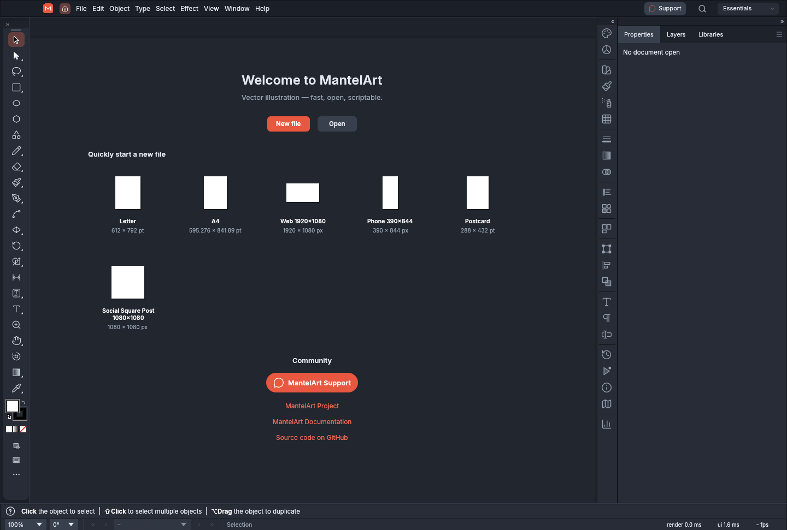

# MantelArt

A native vector illustration application for drawing paths, editing type, composing artwork and exporting SVG, PDF and raster images. The interface, desktop identity, icons, command-line tools and project links use MantelArt.

## Status and limitations

MantelArt is a rebranded derivative of VectorCraft 0.21.0, maintained by ichen27. The upstream drawing engine and native document format are retained. Existing .vectorcraft and legacy .drawcraft documents remain supported; internal vectorcraft-* library names and automation identifiers are intentionally compatible.

This is a development build, not a signed or notarized release. Platform support is inherited; only checks recorded in [validation](docs/mantelart-validation.md) have been verified for this derivative. Automatic update installation is disabled: Help → Check for Updates opens this repository's releases page. No public MantelArt website or Discord is assumed. Project and support links require access to this private repository.

## Prerequisites

- Rust 1.99.1 with Cargo, rustfmt and Clippy.
- Python 3.11+ for the validation audit.
- Inside Mantel (`engines/mantelart`) the prebuilt Mac preview is not included; it stays in the MantelArt repository's Git LFS. Building from source does not need it.
- macOS with Xcode command-line tools; Linux desktop development libraries are listed in the CI workflow; Windows needs the MSVC build tools.
- For the browser build: wasm32-unknown-unknown and Trunk.
- Optional font bundles and platform setup: [development guide](docs/development.md). The app builds without the optional craft-fonts checkout.

## Quickstart

    git clone https://github.com/ichen27/mantelart.git
    cd mantelart
    rustup toolchain install 1.99.1 --component rustfmt,clippy
    rustup target add wasm32-unknown-unknown --toolchain 1.99.1
    cargo run --locked -p mantelart

Open existing artwork:

    cargo run --locked -p mantelart -- examples/neon-drive.vectorcraft
    cargo run --locked -p mantelart-cli -- --help

Build a macOS application bundle:

    cargo xtask bundle
    open dist/MantelArt.app

Build the browser application:

    cd apps/vectorcraft-web
    trunk build --release

The generated website is in dist/web/. Serve it over HTTP; opening the HTML file directly does not load WebAssembly.

## Validation and contribution

    bash ci/run.sh

The entry point checks formatting, Clippy, tests, licensing/assets, layers and WebAssembly using the existing Rust quality gates, plus the MantelArt identity audit. Use focused branches and pull requests. Include reproduction steps and exact checks when reporting a problem. Preserve upstream licenses, file compatibility and unrelated work. See [AGENTS.md](AGENTS.md).

## Artifacts and documentation

| Item | Purpose |
| --- | --- |
| [Artwork sources and icon exports](assets/app-icon/) | Editable SVG plus PNG, Windows ICO and macOS ICNS |
| [Example drawings](examples/) | Editable native illustrations and sample input |
| [Packaging sources](packaging/) | macOS, Windows, Linux, FreeBSD and web packaging |
| [Artifact index](docs/mantelart-artifacts.md) | Deliverables, opening instructions and validation |
| [Architecture](docs/architecture.md) | Engine, renderer, tools and frontend boundaries |
| [Validation record](docs/mantelart-validation.md) | Checks actually performed and remaining limitations |

Older roadmap/parity documents and screenshots are inherited upstream history; they are not fresh claims about this derivative.

## License and attribution

Code is MIT OR Apache-2.0; see [LICENSE-MIT](LICENSE-MIT), [LICENSE-APACHE](LICENSE-APACHE), [NOTICE](NOTICE) and [ATTRIBUTION.md](ATTRIBUTION.md). Based on [VectorCraft by the ArtCraft team and contributors](https://github.com/storytold/vectorcraft). Required notices remain intact; restricted brand marks are removed. Other dependencies and assets retain their own licenses.
