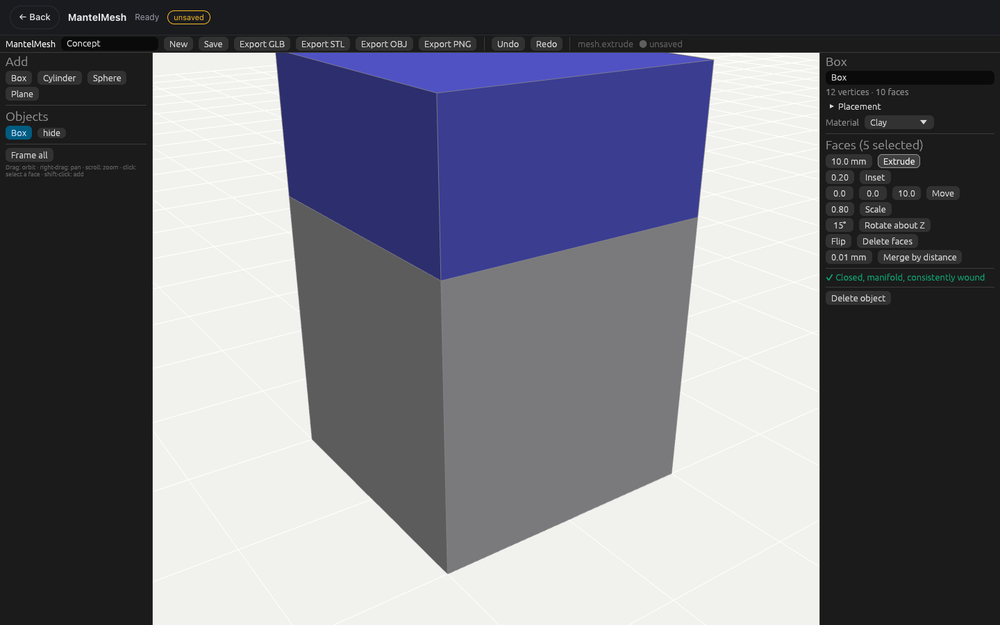
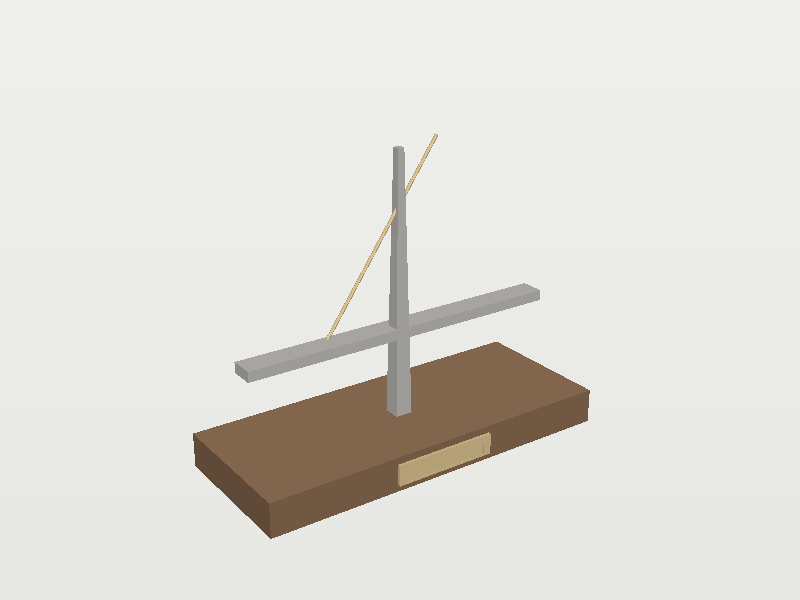

# MantelMesh

A polygon mesh modeller for the Concepts phase of [Mantel](../../README.md): rough shapes, proportions, depth, materials and components, quickly, before anything is dimensioned. Built like the other Mantel engines, in Rust, with one command engine shared by the interface, a CLI and (next) an MCP server and the browser app. See the [design](../../docs/superpowers/specs/2026-11-10-mantelmesh-design.md).





## Status

The first release, in progress:

- **Done:** the core.
  - The editable polygon mesh with topology checks.
  - Primitives: box, plane, cylinder and sphere.
  - Edits: extrude (a whole region), inset, move, scale, rotate, flip, delete and merge by distance.
  - Objects with transforms and PBR materials, including deal-toy presets.
  - Undo and redo.
  - Files: native `.mmesh`, GLB (with `KHR_materials_transmission` for clear acrylic), OBJ in and out, and binary STL.
  - The command registry and `mantelmesh-cli`.
- **Done:** the browser app (`apps/mantelmesh-web`, 4.6 MB): an outliner, a WebGL2 viewport (orbit, pan, zoom, click and shift-click face selection), properties (placement, material presets), the face tools, a live topology check, undo and redo, and the Craft host bridge. In Mantel, Concepts opens it, and each Save keeps a `.mmesh` and a PNG render as the concept's card.
- **Done:** `document.render`, a CPU still render to PNG for cards, agents and the CLI (`--out concept.png`).
- **Next:** modifiers (subdivision, mirror, array, solidify, bevel, boolean), loop cut and bevel edits, an MCP server, and sculpting.

## Prerequisites

Rust 1.99.1 (the toolchain file installs it with rustup).

## Quickstart

```bash
cd engines/mantelmesh
cargo run --locked -p mantelmesh-cli -- run examples/bridge-concept.json --out bridge-concept.glb
cargo run --locked -p mantelmesh-cli -- commands
```

A script is a JSON list of `{"command", "params"}` steps. The output's extension picks the format: `.mmesh`, `.glb`, `.obj` or `.stl`. Units are millimetres with Z up. GLB is written in metres with a Y-up root node, as glTF expects.

## Layout

| Crate | Role |
| --- | --- |
| `crates/mesh` | Vertices and faces as vertex loops. Edges are derived, never stored, so they can't disagree with the faces. `check()` reports non-manifold, open and flipped edges, degenerate faces and stray vertices. |
| `crates/ops` | Primitives and edits as pure functions: a mesh in, a new mesh and a report out. |
| `crates/doc` | Objects, transforms, materials and the snapshot undo journal. |
| `crates/io` | `.mmesh`, GLB, OBJ and STL. |
| `crates/render` | CPU still renders to PNG. |
| `crates/engine` | The session and the self-describing command registry. |
| `crates/ui` | The egui interface, orbit camera, face picking and WebGL2 viewport. |
| `apps/mantelmesh-cli` | Batch scripts and exports. |
| `apps/mantelmesh-web` | The browser app (eframe, glow) with the Craft host bridge. |

## Browser app

```bash
cd apps/mantelmesh-web
trunk build --release
```

Serve `dist/web` over HTTP. Inside Mantel it is built by `engines/build-web.sh mantelmesh` and served at `/apps/mantelmesh/`.

## Validate

```bash
cargo fmt --all --check
cargo clippy --workspace --all-targets --locked -- -D warnings
cargo test --workspace --locked
```

The tests check topology invariants after every operation, including randomised sequences of edits, and check volumes, GLB chunk layout and round trips.

## Examples

[`examples/bridge-concept.json`](examples/bridge-concept.json) is a cable-stayed bridge concept: a walnut base, a deck, a tapered tower, a cable and a recessed logo plate. It comes with its `.mmesh`, `.glb` and `.stl` exports and a render of the GLB in three.js.

## License

MIT OR Apache-2.0 ([LICENSE-MIT](LICENSE-MIT), [LICENSE-APACHE](LICENSE-APACHE)). MantelMesh is new code. It does not include or link Blender or MantelCAD's brand-licensed UI kit, look or theme.
